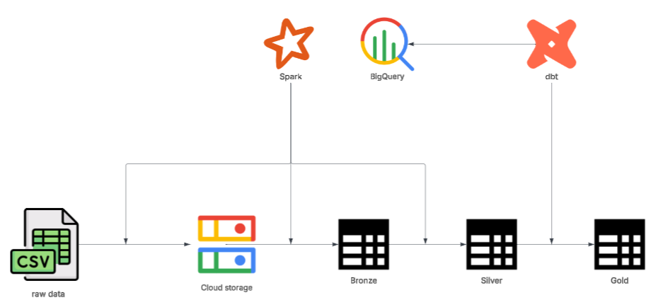
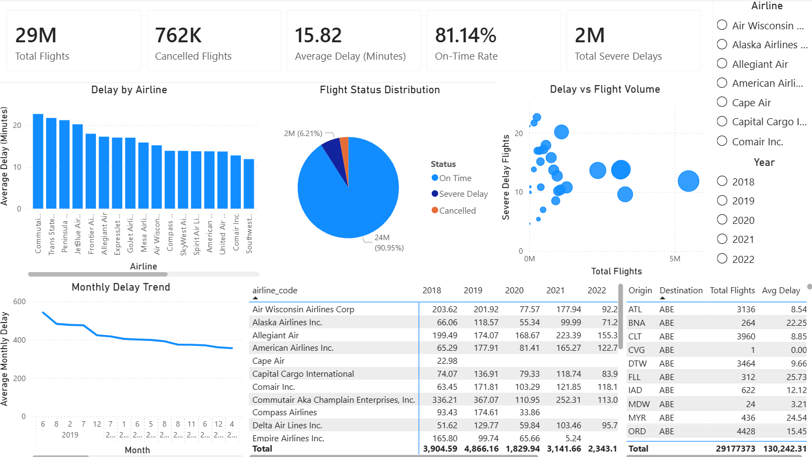

# Flight-Delay
> *the architecture provides a processing and handling built with Spark and dbt using a 5-year historical dataset (2018–2022).*

## Overview
This project processes a historical flight dataset (2018–2022) using a data pipeline. It focuses on transforming raw CSV data into structured data for analysis.

The processing is implemented using Spark for data ingestion and cleaning, and dbt for building analytical layers.

---

## System Architecture
**Bronze layer**: dataset is transferred from local to GCS with the raw data remaining unchanged, and converted into Parquet format partitioned by year to optimize storage.

**Silver layer**: data is cleaned and validated using defined rules, including handling missing values in critical fields such as airport codes, then saved back to GCS.

**Gold layer**: dbt is used to structure the data into a star schema consisting of optimized Fact and Dimension tables, which are further aggregated into Data Marts for analytical use cases and used in Power BI for dashboard visualization.



---

## Data Source
The architecture is built on a historical flight dataset covering the period from 2018 to 2022 as the foundation for its data processing pipeline. The dataset is available at: [Flight Delay](https://www.kaggle.com/datasets/robikscube/flight-delay-dataset-20182022)

---

## Dashboard
The dashboard provides an interactive view of airline performance and delay patterns based on the Gold layer.

It includes key metrics such as total flights, on-time rate, cancellations, average delay, and severe delay rates. Users can analyze trends over time, compare airline performance, and explore route-level patterns.



---

## Folder Structure
```
Flight-Delay/
│
├── analytics_core/
│   ├── models/
│   │   └── gold/
│   │       ├── dim/
│   │       ├── fact/
│   │       └── mart/
│   └── dbt_project.yml
│
├── config/
│   ├── bronze.yml
│   └── silver.yml
│
├── data/
│
├── image/
│   ├── architecture.png
│   ├── dashboard.png
│   └── source.png
│
├── src/
│   └── main/
│       └── java/
│            └── com/FlightDelay/
│                ├── bronze/
│                ├── config/
│                └── silver/
│
├── pom.xml
└── README.md
```